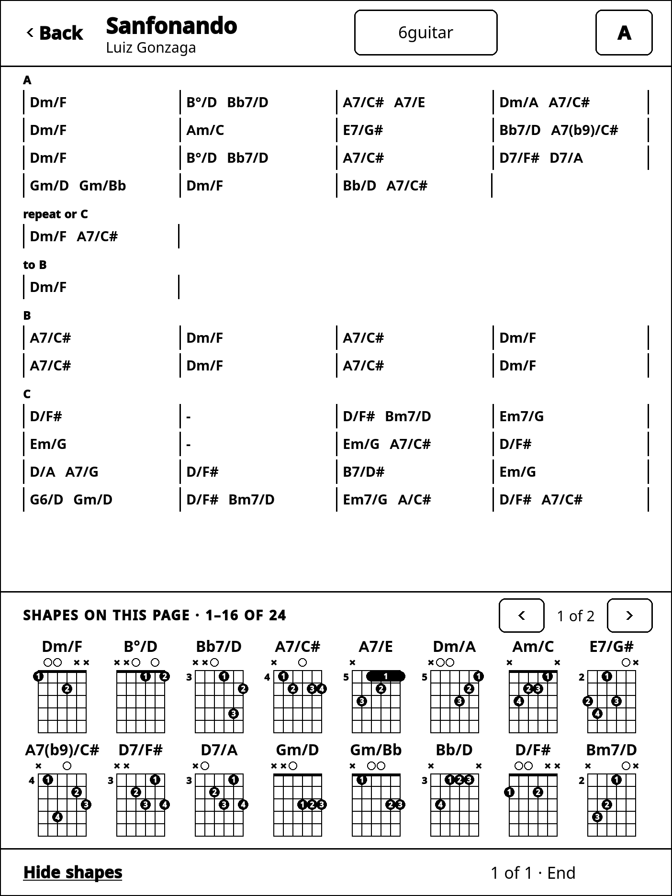

# Estante de Cifras

A shelf of songbooks you play from.

Each book is a git repository of songs written in
[cifra.md](https://github.com/ruoso/cifra.md), cloned into the browser and
kept in step with every device and every person it is shared with. Find a
song across all your books, read it on your own instrument, arrange it, save
versions of it, and sync when there is a network — it works without one.

It runs at [www.estantedecifras.app](https://www.estantedecifras.app), in
English, Brazilian Portuguese, Latin American Spanish and Italian.

Successor to [Explore Chords](https://github.com/ruoso/explore-chords), whose
music engine it carries over.

## What you can do

- **Keep songbooks** — write songs in cifra.md, a plain-text chord format,
  in books on your shelf; bring in books you already have.
- **Read on your instrument** — every song with the shapes of the
  instrument you play, in any key; your own shapes where you have them.
- **Arrange and keep versions** — voice a song your way, in variations;
  every save is a version you can go back to.
- **Setlists and playing** — gather songs into setlists, each in its key,
  and play through them.
- **Share books** — invite people to a book; everyone's changes come
  together, and the app helps where two changed the same song.
- **Print** — a book as a songbook, with an index to tap through.
- **Offline first** — install it from the browser on a phone, a tablet or a
  computer; it works without a network and syncs when there is one.
- **Sign in without a password** — with a passkey, or a link by email.

## On a reMarkable

Your books also read on a **reMarkable** e-ink tablet, made for a music
stand: songs paged for e-ink, in any key, with the shapes of the page under
it, and setlists to play through. It reads only, and updates itself.
[remarkable/README.md](remarkable/README.md) says what it does, and
[remarkable/INSTALL.md](remarkable/INSTALL.md) installs it step by step.

 

## The format

Songs are written in [cifra.md](cifra.md/), a plain-text format for chord
charts and lyrics: readable as it is, and kept as files in git. Its
specification, corpus and implementations live in this repository, and are
published at [github.com/ruoso/cifra.md](https://github.com/ruoso/cifra.md).

## Working on it

How the repository is laid out, how to run and check it, and the plan:
[DEVELOPMENT.md](DEVELOPMENT.md).

## License

[MIT](LICENSE).
