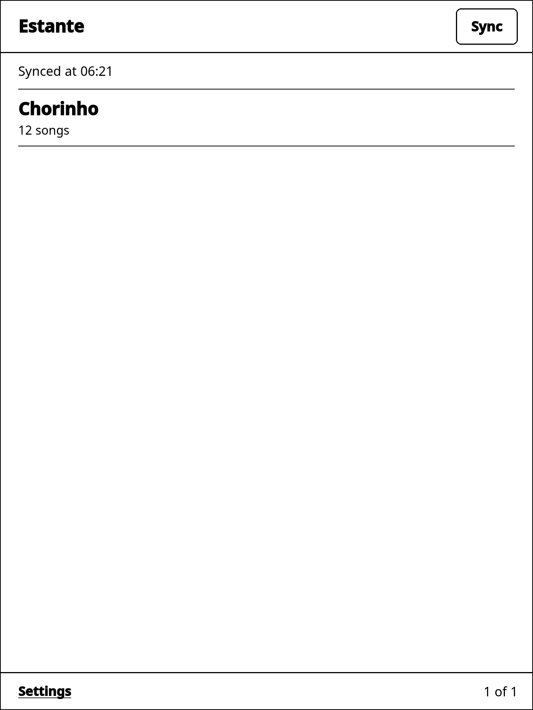
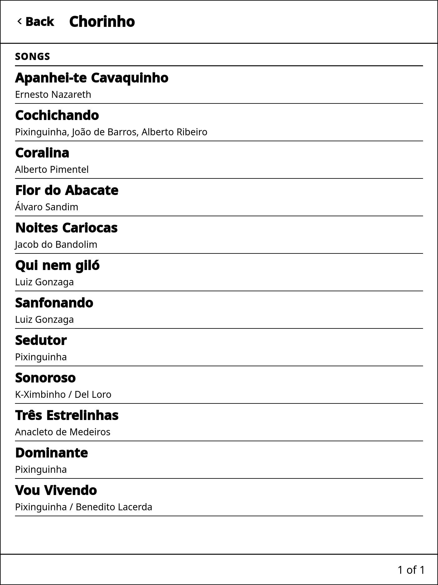
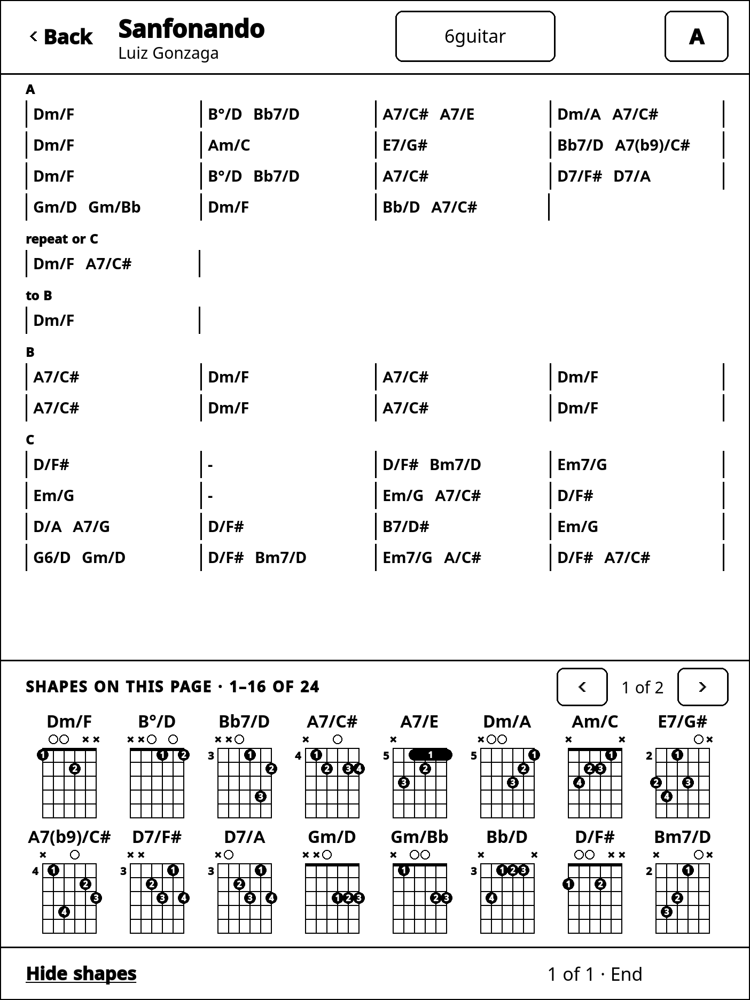

# Estante on the reMarkable

Your Estante songbooks on a reMarkable, for reading on a music stand: the
same books, songs and setlists as on your phone or computer, paged for e-ink,
in any key, with the chord shapes of your instrument under every page.

It reads; it never changes your songs. What you write and arrange stays in
Estante on your phone or computer, and comes to the tablet when it syncs.

## What it does

- **The shelf and your books** — the books on your Estante shelf, each with
  its setlists and its songs; a long book has a row of letters to jump to.
- **A song, in pages** — turned by a tap at the left or right of the page, or
  a swipe. Every page shows the shapes of the chords on it, in a strip at the
  foot; a shape you know can be hidden in every song, and shown again.
- **Any key** — the key button opens the twelve keys; one tap reads the song
  in another, with its shapes. The key you choose stays for that song.
- **A song's variations** — when a song is arranged more than one way for
  your instrument, its variation button chooses between them.
- **Playing a setlist** — *Play* goes through a setlist song by song, each in
  the setlist's key, the next song named at the end of each.
- **Settings** — how chords are named (as written, or as the shapes you play
  sound them), whether bar numbers are shown (at the start of each line, on a
  song that is all chart), the chart's text size (9 to 18 pt), and which of your
  instruments every song is read with. These stay on the tablet; until you
  choose, it follows your account.
- **Offline** — it keeps what it last synced, and syncs again when the tablet
  is on Wi-Fi.
- **Updates itself** — a new version is downloaded in the background and
  starts the next time you open Estante.

## What you need

- A **reMarkable 2**. The reader is also built for the reMarkable Paper Pro,
  but has only been tried on a reMarkable 2.
- **xovi** and **AppLoad**, the community tools that let the reMarkable run
  apps; [INSTALL.md](INSTALL.md) installs them with you, and lists the
  versions it was written against.
- An **Estante account**, at [www.estantedecifras.app](https://www.estantedecifras.app),
  with a book on your shelf.
- A computer, once, to install it over a USB cable or Wi-Fi.

## Installing it

[INSTALL.md](INSTALL.md) takes you from a reMarkable fresh out of the box to
the reader paired with your account, step by step: reaching the tablet,
installing xovi and AppLoad, installing the reader, and pairing — the tablet
shows a short code, and you enter it at
[www.estantedecifras.app/pair](https://www.estantedecifras.app/pair) on your
phone or computer.

## Your account and your data

Pairing gives the tablet a session that can only read: it syncs your books
and nothing else, and you can sign it out from the tablet's Settings or from
*Signed-in devices* in Estante. Your books are kept on the tablet in
`/home/root/.local/share/estante/`, and removed when you sign out.

The reader is published only as releases of this repository on GitHub,
built from its source; the tablet updates from there and nowhere else.

## Working on it

How it is built, tested and released: [DEVELOPMENT.md](DEVELOPMENT.md). The
design: [docs/remarkable-reader.md](../docs/remarkable-reader.md) and
[workflow 19](../docs/workflows/19-remarkable-reader.md).
